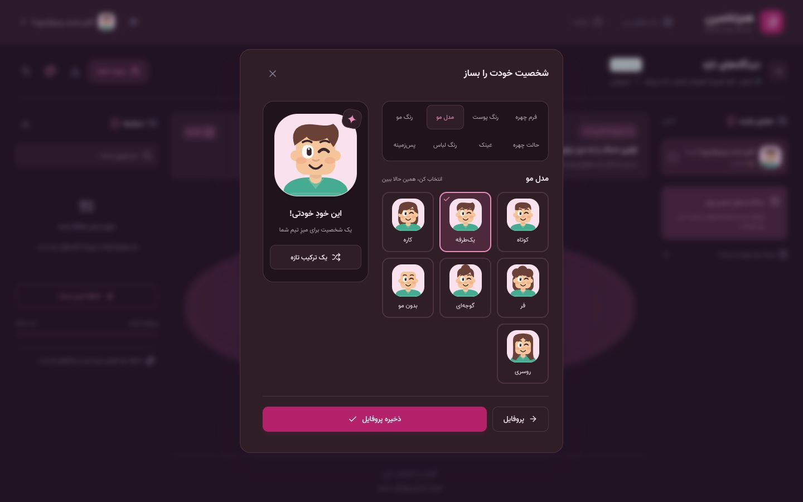
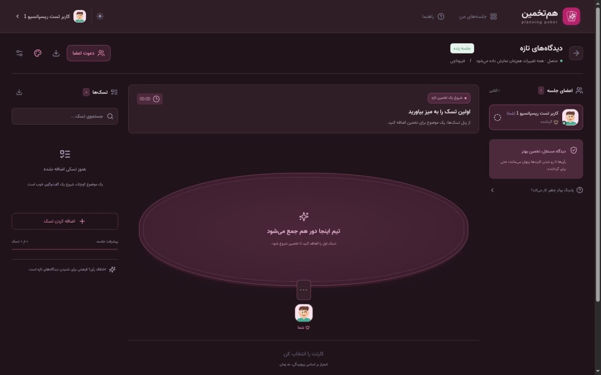
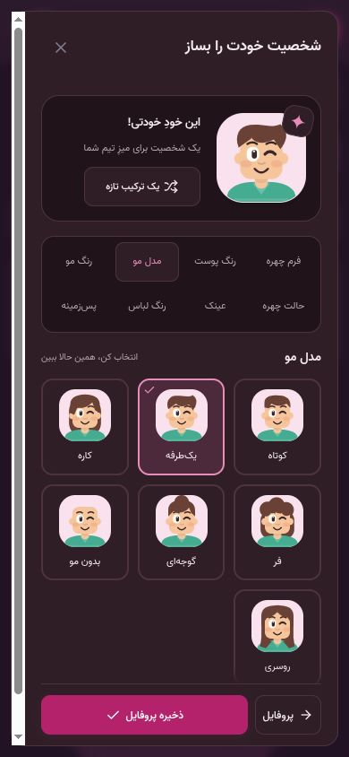

# آواتار و اصلاح تم تیره

تاریخ: 2026-10-13.

برچسب «شروع یک تخمین تازه» اکنون از رنگ‌های همان تم اتاق استفاده می‌کند؛ در حالت صورتی تیره پس‌زمینه `rgb(76, 41, 59)` و متن `rgb(234, 184, 209)` است. برای هر شش تم نیز رنگ محاسبه‌شده بررسی شد.

استایل `.seat-person > span` به خود آواتار هم اعمال می‌شد. نام به کلاس مستقل `.seat-name` منتقل شد؛ آواتار و نام در یک ستون، دقیقاً زیر کارت وسط‌چین‌اند. ابعاد و فاصلهٔ صندلی‌ها برای آواتارهای بزرگ‌تر بازبینی شد.

سازندهٔ آواتار در «حساب کاربری ← ویرایش پروفایل ← شخصیتت را بساز» در دسترس است. 41 گزینه در هشت بخش دارد: چهره، پوست، مدل مو، رنگ مو، حالت چهره، عینک، لباس و پس‌زمینه. پیش‌نمایش زنده و ترکیب تصادفی دارد؛ ذخیره تغییرات را در پروفایل ثبت می‌کند و بستن پنجره تغییرات ذخیره‌نشده را کنار می‌گذارد. دکمه‌های پایین پنجره هنگام اسکرول در دسترس‌اند.

طراحی با الهام از [سازندهٔ رسمی آواتار Duolingo](https://blog.duolingo.com/avatar-creator/) انجام شد. تمام اجزای SVG در همین پروژه طراحی شده‌اند؛ تصویر، کد یا asset از Duolingo یا سرویس خارجی بارگذاری نمی‌شود. کاربران قدیمی بدون تغییر داده، یک شخصیت پیش‌فرض بر اساس نام دریافت می‌کنند. ظاهر سفارشی در `avatar_config` ذخیره می‌شود؛ درخواست‌های قدیمی که این فیلد را ندارند، آن را حفظ می‌کنند.

بررسی‌ها:

- هر 41 گزینه از رابط انتخاب شد؛ پیش‌نمایش، انتخاب رنگ، تغییر تصادفی، کنترل با کلیدهای جهت و حفظ تمرکز در پنجره بررسی شدند.
- ذخیره از رابط، باقی‌ماندن پس از refresh و یکسان‌بودن آواتار پروفایل با آواتار زیر کارت تأیید شد.
- یک تب دیگر اتاق، تغییر آواتار را از SSE دریافت کرد و بدون refresh همان تصویر پیش‌نمایش را نمایش داد.
- بستن سازنده پس از تغییر تصادفی، آواتار ذخیره‌شده را تغییر نداد.
- سازنده، پروفایل و اتاق در عرض‌های 320، 360، 375، 390، 430، 667، 768، 844، 1024 و 1440 بررسی شدند؛ حالت روشن و تیره، اتاق خالی و اتاق 20 نفره پوشش داده شد.
- سازنده در ارتفاع‌های 320 و 360، عرض 414 و مرزهای 599/600 و 1023 نیز بررسی شد. مجموعاً 16 اندازهٔ متفاوت در [دادهٔ خام](avatar-audit.json) ثبت شده است.
- در بررسی‌های موبایل خروج از عرض صفحه یا کنترل کوچک‌تر از 44px مشاهده نشد. فاصلهٔ مرکز آواتار از مرکز جایگاهش صفر بود. بررسی مستقل مستطیل صندلی‌ها، متن میز و بخش رأی‌گیری در 10 اندازه تداخلی نشان نداد.
- تست‌های Go با `-race`، `go vet`، ساخت TypeScript/Vite و Prettier موفق بودند. تست‌های جدید ماندگاری فایل، اطلاع‌رسانی realtime، استقلال دادهٔ ورودی/خروجی، حفظ آواتار در درخواست قدیمی و رد همهٔ دسته‌های نامعتبر را پوشش می‌دهند.

داده‌ها و حساب‌های تست روی فایل مستقل `/tmp` و سرور localhost:8083 بودند؛ دادهٔ برنامهٔ اصلی و پروفایل کاربران واقعی ویرایش نشد. تست مرورگر با viewportهای Chromium انجام شد؛ تست فیزیکی گوشی و Safari/WebKit انجام نشده است. سرور آزمایشی متوقف شد و برنامهٔ اصلی با backend جدید و تنظیمات قبلی فعال است.

