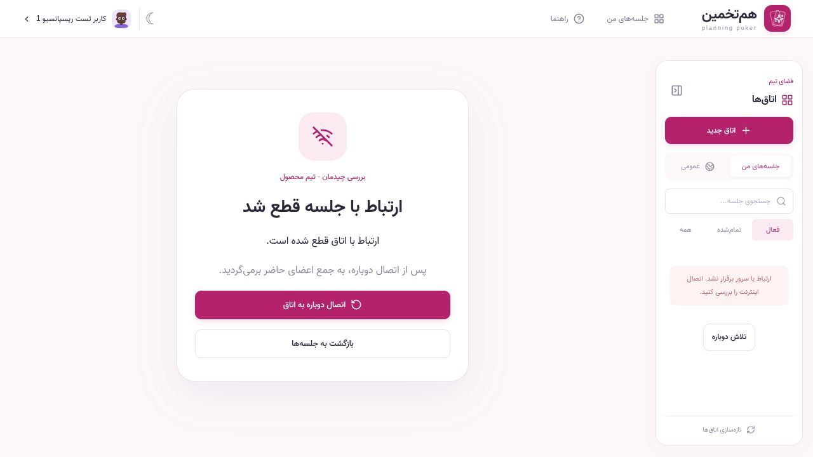
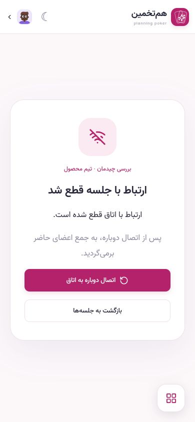

# حضور زنده و قطع اتصال

بررسی 2026-10-13 روی سرور Go در `127.0.0.1:8084` و دیتابیس اختصاصی `poker_layout_qa_01a13592`، با داده‌های ساختگی.

- میز و کارت‌ها پس از snapshot زنده و تأیید `online` کاربر نمایش داده می‌شوند. قطع ارتباط آن‌ها را unmount می‌کند و صفحهٔ اتصال مجدد جایگزین می‌شود.
- افراد آفلاین در فهرست افراد حاضر، میز، تعداد رأی‌دهندگان، ظرفیت و نتیجهٔ دور جاری حساب نمی‌شوند. رأی آفلاین در سرور با `409 disconnected` رد می‌شود.
- عضویت و رأی ذخیره‌شده برای بازگشت باقی می‌مانند؛ نتیجهٔ دور تکمیل‌شده با قطع اتصال اعضا تغییر نمی‌کند.
- چند تب یک کاربر یک صندلی دارند؛ قطع یک تب حضور تب دیگر را حذف نمی‌کند. تب پس‌زمینه اتصالش را حفظ می‌کند. بعد از خروج آخرین تب، تشخیص قطع TCP با heartbeat سرور انجام می‌شود و برای سایر اعضا فوری نیست.
- قطع اینترنت، idle، unavailable، انقضای نشست و قطع پاسخ‌های زنده مدیریت می‌شوند. EventSource در خطای شبکه مجدداً تلاش می‌کند؛ دکمهٔ اتصال مجدد و بازگشت اینترنت هم اتصال تازه می‌سازند. بازگشت صفحه از حافظهٔ history مرورگر اتصال را تجدید می‌کند.

## شواهد

- `GOCACHE=/tmp/poker-presence-go-cache go test -race ./...` و `go vet ./...` موفق بودند. اجرای دوم Go با `TEST_DATABASE_URL` نیز همهٔ تست‌های PostgreSQL را در schemaهای موقت همین دیتابیس QA پاس کرد. cache پیش‌فرض محیط در اجرای اول خطای build داشت؛ اجرای cache موقت موفق شد.
- `npm test`: 26 تست موفق شامل توافق، حضور تأییدشده، قطع، بازگشت، watchdog، انقضا، پایان اتاق، cleanup و snapshot نامعتبر. TypeScript، Vite و Prettier موفق بودند.
- `scripts/smoke.py`: چرخهٔ HTTP/SSE، رأی مخفی، مجوزها، reveal، reset، تخمین، پایان اتاق و خروج موفق بود.
- `scripts/presence_smoke.py`: با socketهای واقعی، بستن یک تب، بستن آخرین تب، رد رأی آفلاین، حذف رأی آفلاین از نتیجه، بازگشت همان رأی و ثابت ماندن تاریخچه بررسی شد. مهلت تشخیص disconnect در این تست 35 ثانیه است تا heartbeat و خطای نوشتن TCP فرصت تکمیل داشته باشند.
- در Chromium با توقف سرور QA، میز و deck حذف شدند؛ پس از راه‌اندازی دوباره، اتصال خودکار کار کرد. تلاش دستی در زمان خاموش بودن سرور هم صفحهٔ قطع اتصال را حفظ کرد. پس از روشن کردن سرور، دکمهٔ اتصال دوباره میز و deck را برگرداند و فقط یک عضو متصل از ۲۰ عضو ذخیره‌شده در فهرست حاضرها نمایش داده شد.
- در دسکتاپ 1280×720 و موبایل 390×844 و 320×568 بیرون‌زدگی افقی دیده نشد. در 390×844 دکمهٔ اتصال در viewport قابل مشاهده بود.

