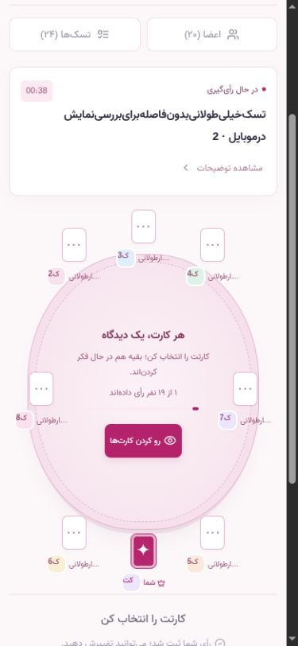
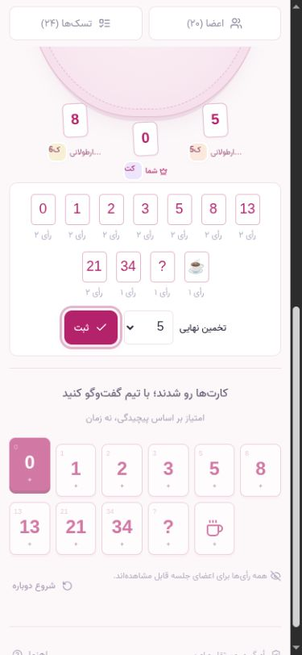
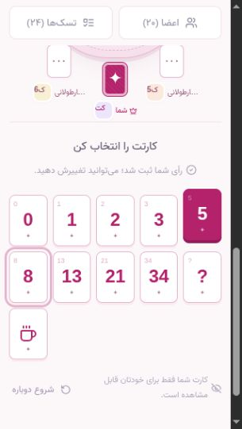

# بررسی فونت و ریسپانسیو

این گزارش مربوط به چیدمان قبلی است. برای پنل‌های جدید جلسه و کارت ثابت اتاق‌ها، [بررسی چیدمان جدید](workspace-layout-review.md) را ببینید.

تاریخ: 2026-10-13. بررسی روی build تولیدی React، از طریق سرور Go انجام شد. در اندازه‌گیری‌های نهایی، بیرون‌زدگی افقی صفحه، خروج کنترل‌ها از عرض صفحه و تداخل صندلی‌ها با متن میز مشاهده نشد.

## فونت

فونت فارسی به **وزیر اصلی (Vazir v30.1.0)** تغییر کرد. فایل variable WOFF2 و مجوز SIL OFL 1.1 از [نسخهٔ رسمی فونت](https://github.com/rastikerdar/vazirmatn/tree/v30.1.0/dist) در `frontend/public/fonts/vazir` قرار دارند. وابستگی قبلی `@fontsource/vazirmatn` حذف شد. فونت با preload و `font-display: swap` از خود برنامه ارائه می‌شود.

در مرورگر، `document.fonts.status` برابر `loaded` و `document.fonts.check('16px Vazir', 'وزیر فارسی')` برابر `true` بود؛ فونت محاسبه‌شدهٔ متن `Vazir, sans-serif` است. دریافت فایل از سرور اصلی پورت 8080 نیز HTTP 200 و 41696 بایت بود.

## اصلاحات

- بیرون‌زدگی کارت‌های تزئینی صفحهٔ اصلی در عرض 320 رفع شد.
- چیدمان سه‌ستونهٔ اتاق تا عرض 1023 به میز و پنل‌های بازشوندهٔ اعضا/تسک‌ها تبدیل شد. پنل فعال پیش از میز نمایش داده می‌شود؛ فهرست‌های بلند ارتفاع محدود و اسکرول مستقل دارند.
- تمام کارت‌های رأی در موبایل در شبکهٔ 5 یا 6 ستونه قرار می‌گیرند؛ برای انتخاب کارت نیازی به اسکرول افقی نیست.
- فاصلهٔ صندلی‌ها، نام‌ها و متن وسط میز اصلاح شد؛ نام‌های بلند با ellipsis و عنوان کامل نمایش داده می‌شوند. در دسکتاپ کوتاه، حداقل ارتفاع میز و فاصلهٔ نتایج افزایش یافت.
- توزیع رأی‌ها و کنترل تخمین نهایی در چند ردیف جا می‌گیرند، حتی با 11 مقدار متفاوت.
- دکمه‌ها، آیکن‌ها و ورودی‌های موبایل حداقل 44×44 پیکسل‌اند. ارتفاع واقعی ورودی جستجو نیز اصلاح شد.
- اندازهٔ متن ورودی‌های موبایل حداقل 16px شد تا از زوم خودکار ناشی از متن کوچک جلوگیری شود.
- پنجره‌ها با ارتفاع `visualViewport` هماهنگ می‌شوند، محتوا اسکرول می‌شود و عنوان/دکمهٔ بستن ثابت می‌ماند. تمرکز صفحه‌کلید بین کنترل‌های فعال همان پنجره می‌چرخد.
- برای متن فارسی بلند، عبارت بدون فاصله و URL بلند، شکست متن و محدودیت اندازهٔ flex/grid اضافه شد.
- safe-area، ارتفاع پویا، حالت افقی، نوار ابزار و پیام‌های موقت در CSS لحاظ شدند.
- فهرست 20 عضو در دسکتاپ اسکرول می‌شود؛ کارت اعضا هنگام محدودشدن ارتفاع فهرست فشرده نمی‌شود.

## ماتریس اندازه‌ها

تمام ابعاد زیر بر حسب **CSS pixel** هستند؛ نام مدل گوشی به معنی اجرای تست روی همان دستگاه نیست.

| گروه | ابعاد عرض × ارتفاع |
| --- | --- |
| گوشی عمودی | 320×568، 360×640، 375×667، 390×844، 414×896، 430×932 |
| گوشی افقی | 667×375، 844×390 |
| تبلت | 768×1024 |
| مرزهای چیدمان | 359×740، 599×800، 600×800، 760×900، 761×900، 1023×768 |
| دسکتاپ | 1024×768، 1280×720، 1440×900 |
| ارتفاع کم برای فرم | 320×320، 390×360 |

در مجموع **20 اندازهٔ متفاوت و 437 اندازه‌گیری** قبل، حین و بعد از اصلاحات ثبت شد. [دادهٔ خام](responsive-audit.json) شامل موارد اولیه و اندازه‌گیری‌های پس از اصلاح نیز هست؛ تمام ردیف‌های آن نتیجهٔ نهایی محسوب نمی‌شوند.

| مسیر/حالت | پوشش |
| --- | --- |
| صفحهٔ اصلی، داشبورد و تاریخچه | 9 اندازهٔ اصلی؛ بازبینی روی build نهایی |
| ورود با شماره و OTP | 9 اندازهٔ اصلی + ارتفاع کم؛ دریافت و استفاده از OTP توسعه |
| حساب، پروفایل، ساخت اتاق | 9 اندازهٔ اصلی؛ فرم پروفایل در ارتفاع کم |
| اتاق فیبوناچی | 20 عضو، 24 تسک، نام و نقش بلند، عنوان بدون فاصله و توضیحات/URL بلند |
| رأی‌گیری، reveal، ثبت تخمین و جلسهٔ بسته | 9 اندازهٔ اصلی؛ کنترل کارت‌ها و تداخل متن میز؛ بررسی دسکتاپ و مرزهای چیدمان |
| پنل اعضا و تسک‌ها | 9 اندازهٔ اصلی؛ بررسی عرض داخلی و اسکرول فهرست‌ها |
| افزودن تسک | 9 اندازهٔ اصلی + ارتفاع کم؛ ذخیرهٔ موفق از پنجرهٔ 320×320 |
| توضیحات، دعوت، تم، تنظیمات، پایان و راهنما | 9 اندازهٔ اصلی؛ بستن توضیحات بلند پس از اسکرول |
| تم‌ها و حالت تیره | هر 6 تم در 320×568 و 844×390؛ نتایج در حالت تیره در 9 اندازهٔ اصلی |
| دستهٔ تی‌شرت | اتاق خالی، رأی XL و نتایج در 9 اندازهٔ اصلی؛ هر 7 کارت داخل عرض صفحه |

در بررسی‌های نهایی موبایل، اسکرول افقی صفحه صفر، تعداد کنترل‌های کوچک‌تر از 44px صفر و اندازهٔ ورودی‌ها حداقل 16px بود. هر 11 کارت فیبوناچی در عرض صفحه قرار داشتند. بررسی جداگانهٔ مستطیل صندلی‌ها و متن/کنترل‌های میز در رأی‌گیری و نتایج، تداخل نشان نداد. هشدار یا خطای console در تب آزمایشی دیده نشد. `npm run build` شامل TypeScript و Vite و بررسی Prettier موفق بودند.

## محیط تست و حدود نتیجه

تست‌ها در Chromium مرورگر داخلی Codex با تغییر viewport انجام شدند. حساب‌ها و جلسه‌های آزمایشی روی سرور جداگانهٔ localhost:8083 و فایل `/tmp` بودند؛ دادهٔ برنامهٔ اصلی تغییر نکرد. پیامک واقعی ارسال نشد. سرور آزمایشی در پایان متوقف شد.

تست **دستگاه فیزیکی iOS/Android، Safari/WebKit، Firefox، صفحه‌کلید واقعی موبایل، بریدگی واقعی نمایشگر و تغییر اندازهٔ فونت سیستم** انجام نشده است. ارتفاع‌های کوتاه فقط فضای باقی‌مانده برای فرم را شبیه‌سازی می‌کنند. بنابراین این گزارش تضمین نبود خطا در تمام گوشی‌ها نیست.

برای تکرار سناریوی شلوغ، `python3 scripts/responsive_fixture.py /tmp/poker-responsive-new.json` یک فایل تازهٔ شامل 20 عضو و 24 تسک می‌سازد و فایل موجود را بازنویسی نمی‌کند. سرور development جداگانه را با `DATA_PATH` این فایل، `APP_ADDR=127.0.0.1:8083` و `ALLOWED_ORIGINS=http://localhost:8083,http://127.0.0.1:8083` اجرا کنید؛ `DATABASE_URL` و تنظیمات webhook پیامک باید خالی باشند. ورود آزمایشی با `09120008800` و OTP توسعه است. این fixture را به دادهٔ اصلی یا production وصل نکنید.

## تصاویر

