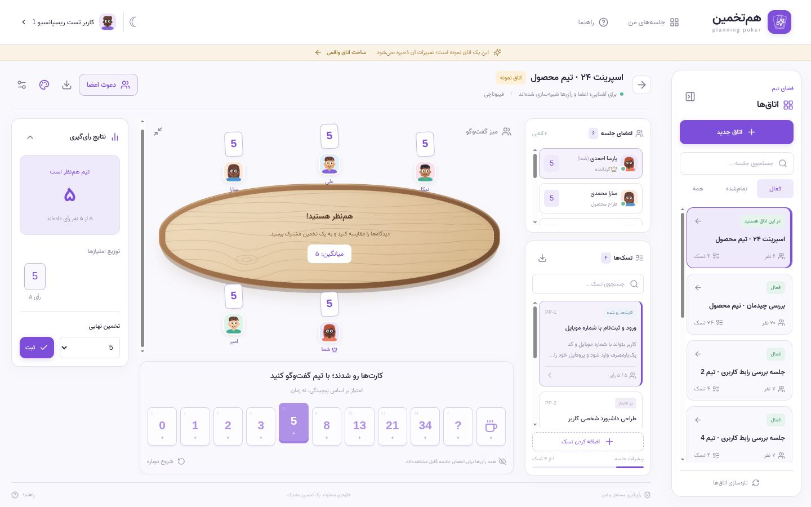
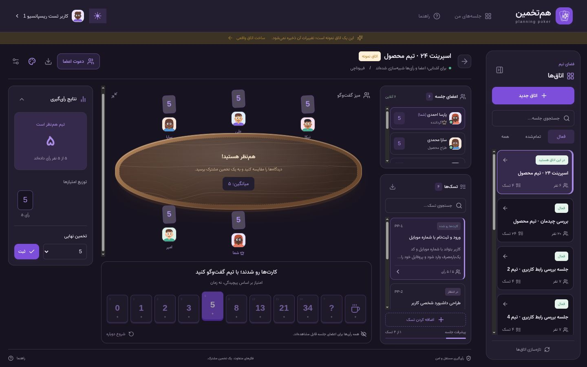
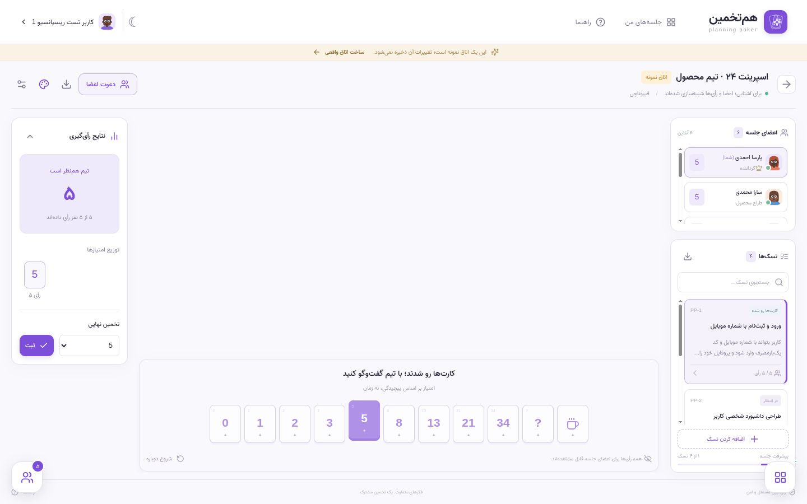
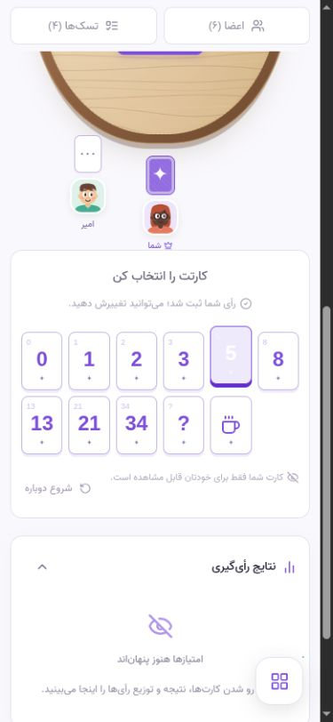

# بررسی چیدمان جلسه

تاریخ: 2026-10-13

تغییرات بعدی حضور اعضا و قطع اتصال در [presence-review.md](presence-review.md) ثبت شده‌اند.

- در دسکتاپ، اعضا و تسک‌ها در یک ستون قرار دارند و هر فهرست اسکرول مستقل دارد. ارتفاع صفحهٔ جلسه به viewport محدود است.
- کارت تکراری تسک از بالای میز حذف شد. عنوان، توضیحات، وضعیت و زمان رأی‌گیری در پنل تسک‌ها هستند. شمارهٔ تسک هنگام جستجو ثابت می‌ماند و با شروع دور جدید، جستجو و اسکرول به تسک فعال برمی‌گردند.
- کارت‌های امتیاز زیر میز قرار دارند. در دسکتاپ کوتاه، خود میز اسکرول داخلی دارد و کارت‌ها در بخش مستقل زیر آن دیده می‌شوند.
- میز با بافت SVG چوب محلی و لبهٔ چوبی نمایش داده می‌شود؛ رنگ چوب و کنتراست متن در حالت روشن و تیره تنظیم شده‌اند.
- با reveal و توافق تمام رأی‌دهنده‌ها روی یک امتیاز، جشن کاغذرنگی 3.6 ثانیه‌ای اجرا می‌شود. ناظرها در شرط رأی‌گیری حساب نمی‌شوند؛ حداقل دو رأی‌دهنده لازم است و کارت‌های «؟» و «☕» تخمین مشترک محسوب نمی‌شوند. رأی پنهان، توافق ناقص، مشاهدهٔ تاریخچه و آپدیت‌های تکراری SSE جشن ایجاد نمی‌کنند. تنظیم کاهش حرکت، کاغذرنگی‌ها را غیرفعال می‌کند و فقط پیام توافق نمایش داده می‌شود.
- نتیجه، میانگین، توزیع رأی‌ها و ثبت تخمین نهایی در پنل جمع‌شوندهٔ سمت چپ نمایش داده می‌شوند. نتیجهٔ تازه با reveal باز می‌شود.
- اتاق‌ها در کارت ثابت سمت راست هستند؛ جلسه‌های شخصی، تاریخچه، جستجو، اتاق‌های عمومی و صفحه‌بندی از همین کارت در دسترس‌اند. در عرض کمتر از 1280، کارت به‌صورت کشویی باز می‌شود. اتاق‌ها و میز گفت‌وگو به آیکن شناور جمع می‌شوند؛ اتصال جلسه و رأی انتخاب‌شده باقی می‌مانند.

## بررسی عملی

Frontend تولیدی با سرور Go روی `127.0.0.1:8084` و دیتابیس مستقل `poker_layout_qa_01a13592` بررسی شد. داده‌ها ساختگی بودند: 10 اتاق و یک جلسه با 20 عضو و 24 تسک.

ورود، انتخاب و تغییر رأی، reveal و توزیع 11 مقدار متفاوت، ثبت تخمین، شروع تسک بعدی، بازگشت به تسک فعال پس از جستجو و اسکرول، اسکرول مستقل فهرست‌ها، جمع‌کردن و بازکردن پنل‌ها، reveal با میز جمع‌شده، حفظ فوکوس، پیوستن به اتاق عمومی، دستهٔ تی‌شرت، صفحه‌بندی، اتاق پر و جلسهٔ پایان‌یافته بررسی شدند. نتیجهٔ جلسه پس از جابه‌جایی بین اتاق‌ها حفظ شد. حالت روشن و تیره نیز بازبینی شدند.

| دسکتاپ | موبایل و تبلت |
| --- | --- |
| 1024×768 | 320×568 |
| 1280×720 | 390×844 |
| 1440×900 | 667×375 |
| 1600×900 | 768×1024 |

در این هشت اندازه، بیرون‌زدگی افقی، خروج کارت امتیاز از عرض صفحه و تداخل اعضا با متن و کنترل‌های میز دیده نشد. در دسکتاپ، ارتفاع صفحه برابر ارتفاع viewport بود. دادهٔ خام در [workspace-layout-audit.json](workspace-layout-audit.json) است؛ مقدار منفی اختلاف عرض، ناشی از فضای scrollbar است و بیرون‌زدگی محسوب نمی‌شود.

`npm run build` (TypeScript و Vite) و Prettier موفق بودند. در تب بررسی، هشدار یا خطای console ثبت نشد. بررسی مرورگر در Chromium انجام شد؛ دستگاه فیزیکی و سایر موتورهای مرورگر بررسی نشدند.

برای تغییرات چوب و جشن، `npm test` شامل 16 تست شرط توافق و چرخهٔ reveal موفق بود. روی API واقعی نیز 18 رأی یکسان از 19 نفر جشن ایجاد نکرد و 19 رأی یکسان جشن ایجاد کرد. جشن پیش از reveal دیده نشد و با ثبت تخمین یا باز کردن دوبارهٔ نتایج تکرار نشد. در اتاق نمونه، انتخاب کارت `5` و رو کردن کارت‌ها، حالت توافق و جشن را نمایش می‌دهد؛ کارت `8` حالت اختلاف رأی را نمایش می‌دهد.

## تصاویر

